  

  
  
  
  

## 👋 About me

I'm **Amr Saad Amer**, a Flutter developer from Egypt with **2+ years** of turning complex business requirements into clean, maintainable mobile apps that ship to real users on Google Play.

- 💼 **Flutter Developer** at **RAR-IT Design & Development LLC** — delivery, marketplaces, parental control and trading products, from architecture to store release
- 🏗️ I care about architecture: **feature-first Clean Architecture**, **Cubit / BLoC**, `get_it` DI, `Either`/`Failure` error handling, SOLID
- 📦 Author of [**`fcm_actions`**](https://pub.dev/packages/fcm_actions) — production-ready notification actions for Firebase Cloud Messaging
- 🤝 Open to challenging projects and collaborating with great teams

## 🛠️ Tech stack

  
  
  
  
  
  
  
  
  
  
  
  

| Area | What I use |
|---|---|
| **Architecture** | Feature-first Clean Architecture · Repository pattern · SOLID · `get_it` |
| **State** | `flutter_bloc` / Cubit |
| **Networking** | Dio · REST · Socket.IO · secure storage |
| **Backend services** | Firebase (Auth, Firestore, FCM, Cloud Functions) |
| **Product** | Maps & location · payments flows · real-time chat · localization (AR/EN) · Play Store releases |

## 📦 Open source

<table>
  <tr>
    <td width="100%">
      <h3><a href="https://github.com/AmrSaad14/fcm_actions">fcm_actions</a>
        
      </h3>
      Production-ready notification actions, tokens, topics and routing for Firebase Cloud Messaging on <b>Android, iOS, macOS and web</b>.
      Normalizes FCM payloads, registers Android channels and Apple categories, routes taps, handles inline replies and exposes typed event streams — with no native code required in the host app.
        
      <code>dart</code> · <code>firebase</code> · <code>notifications</code> · <code>deep links</code>
    </td>
  </tr>
</table>

## 📱 Apps I've shipped

| App | Category | Highlights |
|---|---|---|
| [**SouqMazad**](https://play.google.com/store/apps/details?id=com.souqmazadeg.app) | Marketplace & Auctions | Buy / sell / bid, AI search, real-time chat |
| [**Dw2ni Customer**](https://play.google.com/store/apps/details?id=com.rar_it.dw2ni.customer) · [**Driver**](https://play.google.com/store/apps/details?id=com.rar_it.dw2ni.driver) · [**Restaurant**](https://play.google.com/store/apps/details?id=com.rar_it.dw2ni.restaurant) | Food Delivery | Three-app ecosystem: ordering, live tracking, merchant ops |
| [**Kid Sentry Parent**](https://play.google.com/store/apps/details?id=com.rarit.kid_sentry_parent) · [**Child**](https://play.google.com/store/apps/details?id=com.rarit.kid_sentry_child_app) | Family Safety | Screen time, location, app rules, background sync |
| [**Rizq**](https://play.google.com/store/apps/details?id=com.rar.rizq) | Classifieds | Ads for products, homes, cars & jobs, buyer–seller chat |
| [**ShamZone**](https://play.google.com/store/apps/details?id=com.shamzone.markethub) | Marketplace | Location-aware listings, chat with sellers |

> Plus **Cash W Beblash** (classifieds with subscriptions & payments) and **Bindo**.

## 🚀 Featured projects

| Project | Description | Stack |
|---|---|---|
| [**portfolio**](https://github.com/AmrSaad14/portfolio) | My personal portfolio built entirely with Flutter Web, auto-deployed to GitHub Pages — [live ↗](https://amrsaad14.github.io/portfolio/) | Flutter Web · Cubit · GitHub Actions |
| [**hussien-fit**](https://github.com/AmrSaad14/hussien-fit) | Premium online-coaching platform with client & trainer roles, programs and pricing | Flutter Web · Firebase · Cloud Functions · Vercel |
| [**coinly**](https://github.com/AmrSaad14/coinly) | Flutter app built on a pragmatic three-layer (data / logic / UI) architecture | Flutter · BLoC · Firebase |

## 📊 GitHub activity

  <picture>
    <source media="(prefers-color-scheme: dark)" srcset="https://raw.githubusercontent.com/AmrSaad14/AmrSaad14/output/github-contribution-grid-snake-dark.svg"/>
    <source media="(prefers-color-scheme: light)" srcset="https://raw.githubusercontent.com/AmrSaad14/AmrSaad14/output/github-contribution-grid-snake.svg"/>
    
  </picture>

---

  <i>Building maintainable systems is what creates long-term value — code is only part of the job.</i>  
  <a href="https://www.linkedin.com/in/amr-saad11595/">Let's connect</a> · <a href="mailto:amrsaadamer14@gmail.com">amrsaadamer14@gmail.com</a>

